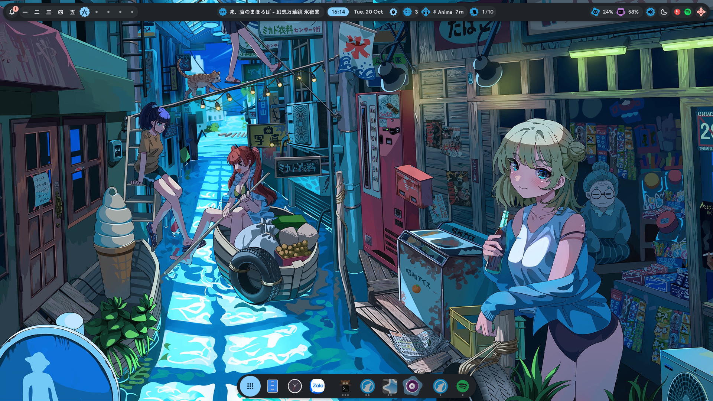
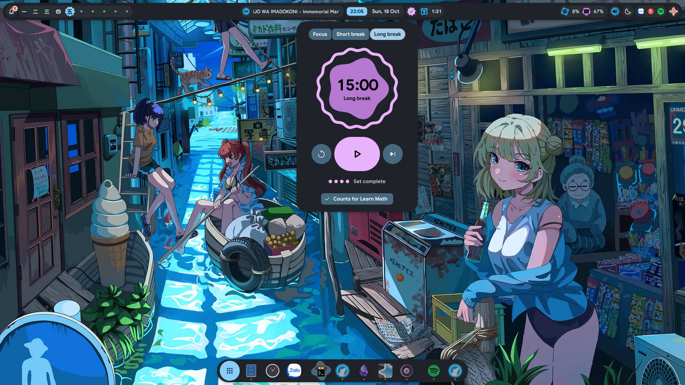
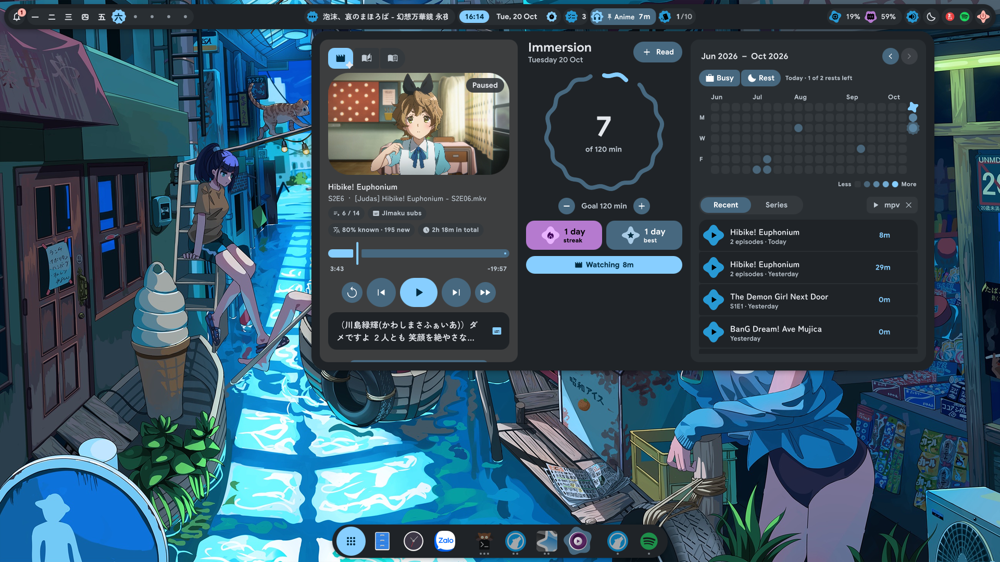
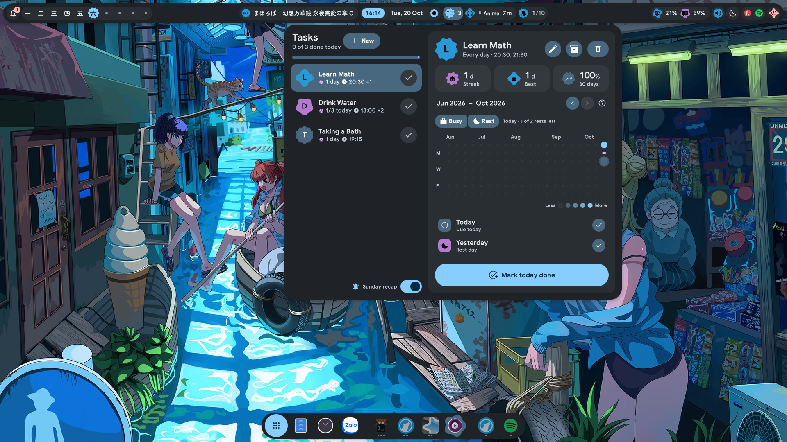
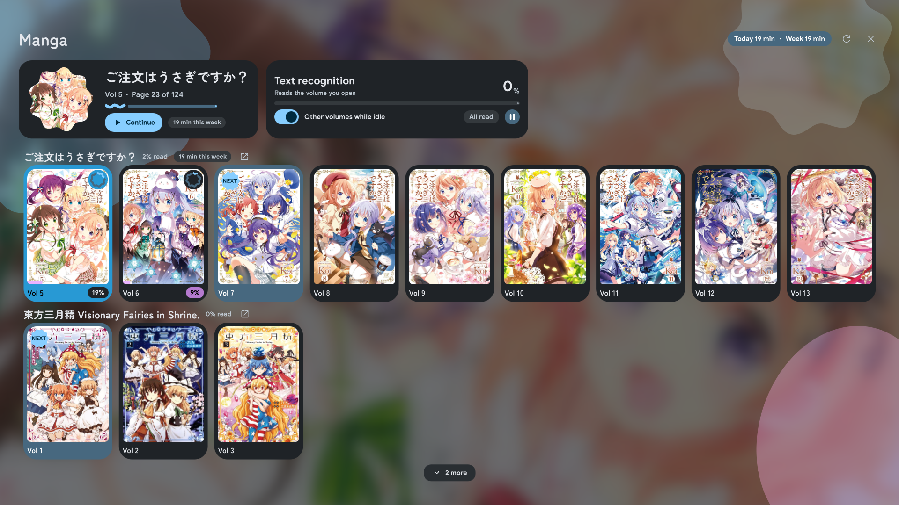
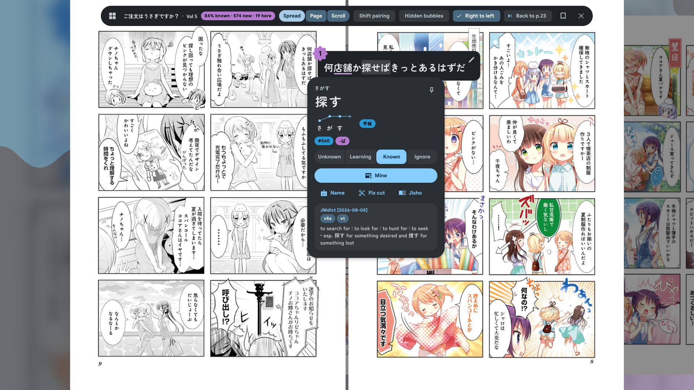

# dotfiles

Arch, Hyprland, Quickshell, Neovim. Colours come from the wallpaper through matugen.



## What is in here

- `.config/quickshell`: the shell. Bar, dock, launcher, notifications, lock screen, wallpaper switcher, clipboard, control center, a library shelf for anime and manga, a manga reader and a few panels of my own (below).
- `.config/hypr`: Hyprland config in Lua.
- `.config/matugen`: templates that turn the wallpaper colours into Quickshell, Hyprland and editor themes.
- `.config/mpv`: mpv config and scripts: the immersion logger, Jimaku subtitle fetching and the keys for the interactive subtitles.
- `.config/nvim`: LazyVim.
- `wallpaper/`: wallpapers.

## Panels

**Focus timer.** Pomodoro in the bar clock. Focus, short break and long break roll into each other without stopping. A finished focus session counts toward a task.



**Immersion tracker.** Counts time spent on Japanese media. mpv playback is logged automatically when the audio is Japanese. Books from ttu are read from their own data and manga from the reader below. There is a daily goal, a streak and a heatmap. While an episode plays, the card shows how much of its subtitles you already know (for example "80% known · 195 new").



**Tasks.** Daily habits with a target per day, reminders, a streak and a heatmap.



**Interactive subtitles.** In a fullscreen mpv the shell redraws the subtitle line so each word can be hovered, a bit like Migaku. Words are cut with fugashi and looked up through the Yomitan API. Unknown words are underlined, words being learned get a second colour, and known words stay plain. Known words come from Anki. Hovering opens a card with the definition, pitch accent and frequency; it can mark a word known or ignored, fix a name or a bad cut, and mine it into Anki (the audio and picture come from mpvacious). Resting on the right screen edge opens a transcript of the whole episode. Furigana can be shown over unknown words, all words or none (`Alt+f`).

**Manga reader.** A fullscreen overlay with its own Rust backend (`.config/quickshell/reader`, `qs-manga`) that reads the manga folders and archives directly. Spread, single page and vertical scroll, right to left per series, zoom and pan, a page scrubber with bookmarks, and progress that picks up where you stopped. Text is read ahead of you by a background worker (comic-text-detector for the bubbles, a manga-ocr model for the text), only while the computer is idle. Hovering a bubble opens its words with the same underlines and word card as the subtitles, so a word can be marked known or mined into Anki with the sentence and a picture of the bubble and its panel. Wrong text can be fixed or a junk bubble hidden (right click). The top bar shows how much of the volume you can already read ("84% known"), and finished volumes go to AniList.





**Jimaku subtitles.** mpv fetches Japanese subtitles from jimaku.cc when a file loads and cleans them up (ASS to SRT, no karaoke or Chinese lines). `Alt+j` opens a panel to pick another file, block an author or point the show at another entry.

Also in there: screenshots and screen recording (grim, gpu-screen-recorder), an OCR snip overlay for anything on screen (manga-ocr or PaddleOCR), synced lyrics for whatever is playing, and a wallpaper picker, an alarm and a restore of the last session after a reboot.

## Setup

The repo is a bare repo with `$HOME` as the work tree.

```sh
git clone --bare git@github.com:Dxd231/dotfiles.git $HOME/.cfg
alias cfg='git --git-dir=$HOME/.cfg --work-tree=$HOME'
cfg checkout        # move any existing files out of the way first
cfg config status.showUntrackedFiles no
```

Needed for the shell: quickshell, hyprland, matugen, awww, cliphist, wl-clipboard, grim, slurp, gpu-screen-recorder, mpv. Optional: manga-ocr or paddleocr for the OCR overlay, ydotool. For the manga reader: a Rust toolchain (`.config/quickshell/reader/install.sh` builds `qs-manga`), libarchive and unrar for archives, and a venv at `~/.venv/mokuro` with mokuro and manga-ocr for the page text. For the interactive subtitles: a Python venv with fugashi and unidic-lite at `~/.venv`, the Yomitan API extension in a running browser, Anki with AnkiConnect, and mpvacious.

Fonts: Google Sans and Zen Maru Gothic.

Quickshell hot-reloads, but a new component file needs a shell restart before it is picked up.
